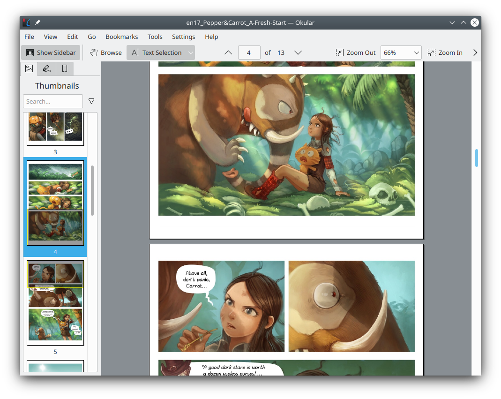
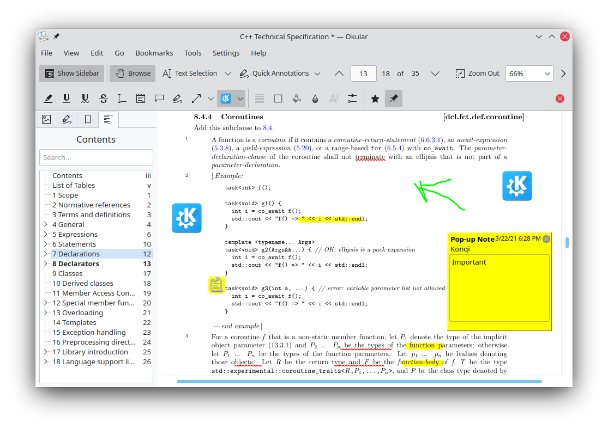

# Okular Universal Document Viewer for Reading and Review

Okular brings document viewing, navigation, and annotation into one KDE application.
Read PDFs, books, comics, and supported image formats through a shared interface.

[](https://github.com/okular-kde/okular-kde/releases/)

## What Is Okular?

The Okular KDE project develops a document viewer with format-specific backends.
The desktop shell provides the reading workspace, while generators handle individual document types.

Use the Okular PDF workflow to read a report, inspect its contents, and add review notes.
Available operations depend on the format, backend, and document itself.

### Reading and Review

- Navigate through pages, thumbnails, and document contents.
- Search text that the document makes available.
- Highlight passages and add supported annotations.
- Select content for copying into another application.
- Magnify small details while reading.
- Present a document in presentation mode.

## Document Formats

| Document type | Typical use | Backend consideration |
| --- | --- | --- |
| PDF | Reports, forms, and review copies | Uses the Poppler backend |
| PostScript | Print-oriented documents | Uses libspectre |
| DjVu | Scanned publications | Uses DjVuLibre |
| EPUB | Reflowable electronic books | Requires EPUB support in the build |
| Comic archives | CBR and CBZ collections | Requires the comic book generator |
| Images | Viewing supported image files | Capabilities vary with the image format |
| Markdown | Reading formatted text documents | Requires the Markdown generator |

Format support is modular rather than identical across every package.
A backend that opens a document does not necessarily support every annotation or export operation.



### Format Discovery During Builds

The EPUB lookup is defined in [FindEPub.cmake](cmake/modules/FindEPub.cmake).
DjVu dependency detection is handled by [FindDjVuLibre.cmake](cmake/modules/FindDjVuLibre.cmake).

PostScript dependency lookup lives in [FindLibSpectre.cmake](cmake/modules/FindLibSpectre.cmake).
Markdown library detection is described in [FindDiscount.cmake](cmake/modules/FindDiscount.cmake).

## PDF Annotations

The Okular PDF reader supports native PDF annotations.
Use highlights for passages, notes for comments, and drawing tools where the document supports them.

### A Review Workflow

1. Open the document and inspect its page structure.
2. Locate the passage that needs attention.
3. Add an annotation with enough context for another reader.
4. Save the annotated document.
5. Reopen the saved copy to check the result.

Annotations record comments and markup.
They should not be treated as a substitute for editing the original page content.

The generator saving contract is described in [saveinterface.h](interfaces/saveinterface.h).
A format backend implements the operations it can support.

## Navigation and Command Line

The Okular document viewer can open a named file directly from a terminal.
Command-line options also support an initial page, text search, and presentation mode.

```bash
okular --page 12 "review-copy.pdf"
okular --find "conclusion" "review-copy.pdf"
okular --presentation "slides.pdf"
```

These are independent examples for an available Okular executable.
The search option applies when a single document is supplied.

Text search relies on text exposed by the document and its backend.
An image-only scan may not provide searchable text.

### Viewer Integration

Basic document-viewer integration is declared in [kdocumentviewer.h](kdocumentviewer.h).
Advanced viewer controls have a separate contract in [viewerinterface.h](interfaces/viewerinterface.h).

Generator actions can interact with the interface through [guiinterface.h](interfaces/guiinterface.h).
The extra print-options widget interface is defined in [printinterface.h](interfaces/printinterface.h).

## Settings and Configuration

Okular separates core settings from the settings used by its viewing interface.
This lets shared document behavior and interface behavior remain distinct.

The interface settings schema is [okular.kcfg](conf/okular.kcfg).
Core options, including memory and rendering settings, are declared in [okular_core.kcfg](conf/okular_core.kcfg).

### Generated Settings Classes

The core settings compiler input is [settings_core.kcfgc](conf/settings_core.kcfgc).
Its class and source schema are identified with entries such as these:

```ini
ClassName=SettingsCore
NameSpace=Okular
File=okular_core.kcfg
Mutators=true
Singleton=true
```

This is developer input for KDE's settings code generator.
It is not an end-user preferences file to paste into a configuration directory.

The desktop settings compiler input is [settings.kcfgc](conf/settings.kcfgc).
Generator-specific configuration uses the interface in [configinterface.h](interfaces/configinterface.h).

## Source Components

The project contains several components that share document-viewing functionality.

| Component | Responsibility |
| --- | --- |
| Desktop shell | Standalone desktop application |
| KParts plugin | Embeddable document-viewing component |
| Kirigami application | Mobile-oriented interface |
| Document generators | Format loading, rendering, and supported operations |

The KParts plugin metadata is [okular_part.json](okular_part.json).
It identifies the generator plugin namespace used by the component.

Installed CMake package dependencies are declared through [Okular6Config.cmake.in](Okular6Config.cmake.in).
This package configuration serves software that integrates with Okular's exported targets.



## Build Instructions

Build from a complete Okular source checkout with the required development dependencies.
The selected branch determines the precise Qt, KDE Frameworks, and backend library requirements.

### Select the Interface

The CMake option `OKULAR_UI` accepts `desktop`, `mobile`, or `both`.
The following example selects the desktop interface and a separate user-owned prefix.

```bash
cmake -S . -B build \
  -DCMAKE_BUILD_TYPE=Release \
  -DCMAKE_INSTALL_PREFIX="$HOME/opt/okular" \
  -DOKULAR_UI=desktop
cmake --build build --parallel
cmake --install build
```

Backend availability depends on the development libraries discovered during configuration.
Review CMake's dependency report before assuming that every format will be included.

### Tests and Runtime Environment

The project's instructions require installation before manually running its tests.
A custom prefix can also require the generated environment script.

```bash
source build/prefix.sh
ctest --test-dir build --output-on-failure
okular "test-document.pdf"
```

Run these commands from the source directory after building and installing.
The final command is a separate manual viewing check, not an automated test.

## Contributing and Bug Reports

Okular uses merge requests for code contributions.
Follow the project's pre-commit and formatting requirements before requesting review.

Report reproducible bugs through KDE Bugzilla.
Include the application version, document format, and steps needed to reproduce the problem.

A minimal shareable sample can help distinguish a backend issue from an interface issue.
Check that the sample does not contain material you cannot share.

Project credits are maintained in [aboutdata.h](aboutdata.h).
They identify Piotr Szymanski as the developer who created Okular from the KPDF codebase.

## Release Line

The stable 26.08 series includes the 26.08.3 source release.
Distribution packages can follow their own publication schedules.

For Okular Linux packages, check the version supplied by the chosen distribution channel.
A development checkout may contain changes beyond the stable release.

## Related Search Terms

okular kde, okular pdf, okular pdf reader, okular document viewer, okular linux, pdf, pdf-viewer, document, viewer, kde, qt, linux, annotations, epub, djvu
